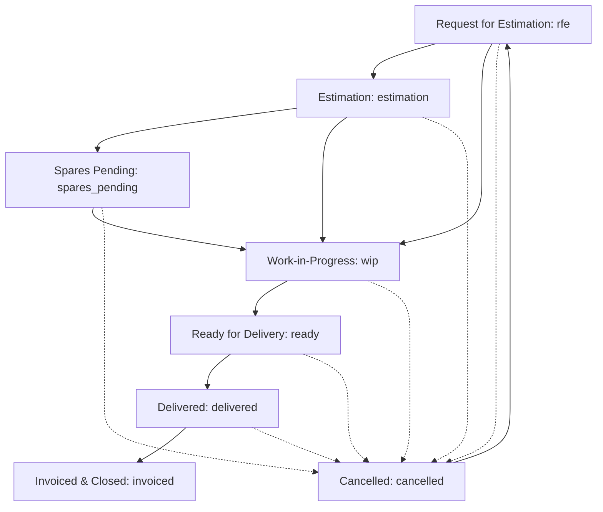

# ⚙️ HAPPY CAR WASH GMS — SOFTWARE CONTEXT FILE
# Version: 2.0 | Updated by: AI Context Agent | Project: Happy Car Wash GMS | Last Updated: June 2026

---

## 🚦 MANDATORY RULES FOR ALL AI AGENTS

Read these rules completely before touching any file in this project.

### RULE 1 — READ THIS FILE FIRST
Every AI agent working on this codebase MUST read this entire file before
making any change. No exceptions. This file is the ground truth.

### RULE 2 — UI/UX IS FROZEN
Do NOT modify frontend design, layout, colors, fonts, spacing, icons, animations,
sidebar structure, or shared components UNLESS the user explicitly says:
"Change the UI" or "Update the design" or gives a specific UI instruction.
Safe to do without asking: backend logic, new API endpoints, new DB tables,
bug fixes in data processing, new backend-only features.

### RULE 3 — STATUS PIPELINE IS SACRED
The job card status pipeline (rfe → estimation → spares_pending → wip → ready →
delivered → invoiced) and its VALID_TRANSITIONS map in jobCards.js MUST NOT be
altered without explicit instruction. This is core business logic.

### RULE 4 — NEVER RUN schema.sql ON EXISTING DB
schema.sql is for fresh installs only. For schema changes on existing databases,
create a new migration_*.sql file and a corresponding runner script.

### RULE 5 — AUTH MUST STAY INTACT
Do not modify auth.js, AuthContext.tsx, or the axios.ts interceptors without
understanding the full auth chain. Breaking auth locks out all users.

### RULE 6 — ALWAYS USE PARAMETERIZED QUERIES
All MySQL queries MUST use parameterized queries (?, ?) — never string interpolation.

### RULE 7 — FOLLOW EXISTING NAMING CONVENTIONS
- Backend route files: camelCase (jobCards.js, partsSales.js)
- Frontend pages: PascalCase (JobCards.tsx, PartsSales.tsx)
- API endpoints: kebab-case (/api/job-cards, /api/parts-sales)
- DB tables: snake_case (job_cards, parts_sales)
- Number formats: match existing generators (SCW-J, RFE-, INV-, NGST-, EST-)

### RULE 8 — DEMO MODE MUST STAY FUNCTIONAL
If you add a new API endpoint or change an existing response shape, you MUST
also update demoData.ts with matching mock data to keep demo mode working.

### RULE 9 — USER DISPLAY NAME
The administrator name display must remain as "Admin" globally. Do NOT restore or reference "GK Admin" or any other legacy workshop name in user profile badges, navigation titles, database records, or layouts.

---

## SECTION 1 — PROJECT OVERVIEW

HAPPY CAR WASH GMS is a localized Garage Management System (GMS) custom-built for **Happy Car Wash**, an automotive detailing and service workshop located in Vadodara, Gujarat. The software functions as a comprehensive enterprise resource planning (ERP) tool designed to manage the shop's operational pipelines, finances, personnel, and customer relations. 

The software utilizes a robust and modern technical stack:
- **Backend**: Built on **Node.js** and **Express**, using **MySQL** (via `mysql2/promise` with connection pooling) as its primary relational store. Protected endpoints utilize **JSON Web Tokens (JWT)** for authentication, with dispatch utilities connecting to the **MSG91** gateway for SMS and WhatsApp communications.
- **Frontend**: Developed in **React 19** with **TypeScript** and **Vite**, styled using **Tailwind CSS** and **Vanilla CSS modules** for advanced styling, utilizing **Framer Motion** for premium interactive animations, and **Recharts** for business analytics.
- **Deployment**: The system is designed for local-first execution. The frontend is fully static-built (`dist`) and Vercel-ready with a built-in mock **Demo Mode** (`VITE_DEMO_MODE=true`) allowing complete client-side execution, bypassing the database backend to demonstrate core functionality without server infrastructure.

---

## SECTION 2 — REPOSITORY STRUCTURE

```
happy-car-wash/
├── backend/
│   ├── src/
│   │   ├── server.js                        ← Express app entry point; mounts routes and sets middleware
│   │   ├── config/
│   │   │   ├── db.js                        ← MySQL2 connection pool (env-driven host, user, pass, database)
│   │   │   ├── schema.sql                   ← Base DB schema (admin_users, staff, job_cards, invoices, estimates, etc.)
│   │   │   ├── runAllMigrations.js          ← Main migration script executor for incremental migrations
│   │   │   ├── runSchema.js                 ← Script to drop database and initialize fresh schema.sql
│   │   │   ├── setupDb.js                   ← Script to create database if not exists and execute base schema.sql
│   │   │   ├── seed.js                      ← Basic user seed script (admin_users)
│   │   │   ├── fullSeed.js                  ← Comprehensive operational seed script (staff, parts, job_cards, ledger)
│   │   │   ├── seedParts.js                 ← Dedicated parts catalog seed script
│   │   │   ├── populate-csv.js              ← Custom loader populating vehicle_master table from car model dataset.csv
│   │   │   ├── migration_sms_module.sql     ← SMS/WhatsApp module: extends bill_dispatch_log, seeds all MSG91 template keys into settings table
│   │   │   ├── migration_v5_changes.sql     ← V5 changes: adds concern_id FK column to job_card_services
│   │   │   └── migration_*.sql              ← Incremental database migration files
│   │   ├── middleware/
│   │   │   └── auth.js                      ← JWT Bearer token validator; implements URL query-param token fallback
│   │   ├── routes/                          ← Backend API resource routers
│   │   │   ├── accounts.js                  ← Account summary and transaction reports
│   │   │   ├── advanceBookings.js           ← Operations: advance booking management
│   │   │   ├── attendance.js                ← People: employee punch-in / punch-out and daily logs
│   │   │   ├── auth.js                      ← User sessions: JWT generation (/login) and profile verification (/me)
│   │   │   ├── cashLedger.js                ← Finance: physical cash ledger transactions
│   │   │   ├── customerPayments.js          ← Finance: customer cash ledger records
│   │   │   ├── customers.js                 ← CRM: customer directory and vehicle mappings
│   │   │   ├── dashboard.js                 ← Operations: daily metrics and last-7-days revenue chart data
│   │   │   ├── estimateJobs.js              ← Operations: standalone/GST estimate management
│   │   │   ├── exports.js                   ← System: XLSX export dispatchers using SheetJS
│   │   │   ├── imports.js                   ← System: Excel bulk-importer processor
│   │   │   ├── inspections.js               ← Operations: after-service concerns and checklists
│   │   │   ├── jobCards.js                  ← Operations: primary status pipeline, invoices, and estimates
│   │   │   ├── notifications.js             ← System: real-time notification aggregator for low stock, bookings, and status changes
│   │   │   ├── parts.js                     ← Finance: parts inventory stock adjustments and alerts
│   │   │   ├── partsSales.js                ← Finance: retail spare parts sales transactions
│   │   │   ├── productSales.js              ← Finance: accessory and merchandise sales entries
│   │   │   ├── publicTracking.js            ← System: unauthenticated public customer tracking link endpoints
│   │   │   ├── quickJobCards.js             ← Operations: express single-button job card creation
│   │   │   ├── quotations.js                ← Operations: estimate catalog and wipe utilities
│   │   │   ├── reports.js                   ← Finance: daily summary sheet exports
│   │   │   ├── salary.js                    ← People: payroll tracking and payouts
│   │   │   ├── serviceBookings.js           ← Operations: service booking calendar and status board
│   │   │   ├── serviceCatalog.js            ← Operations: master catalog presets (mechanic, detailing, AC)
│   │   │   ├── settings.js                  ← System: shop settings configurations (logo, GSTIN, prefix)
│   │   │   ├── staff.js                     ← People: employee registry management
│   │   │   ├── vehicleMaster.js             ← Operations: model and variant autocomplete catalog
│   │   │   └── vehicles.js                  ← CRM: vehicle lookup and history directory
│   │   └── utils/
│   │       ├── excel.js                     ← Excel document response helper
│   │       └── msg91.js                     ← MSG91 WhatsApp/SMS API integration helper
│   ├── migration_fix_services_endpoint.sql  ← Hotfix: adds is_selected and sort_order columns to job_card_services
│   ├── uploads/                             ← Store path for user media (job card photos)
│   ├── .env                                 ← Environment keys (auth, DB, and integrations)
│   └── package.json                         ← CommonJS entry point and dependencies (express, mysql2, xlsx, multer)
│
├── frontend/
│   ├── src/
│   │   ├── main.tsx                         ← React DOM entry point wrapping App inside StrictMode and AuthProvider
│   │   ├── App.tsx                          ← Core routes, theme initialization, and visibility protection
│   │   ├── index.css                        ← Tailwind direct imports and custom scrollbar styles
│   │   ├── api/
│   │   │   ├── axios.ts                     ← Axial instance attaching tokens and handling automatic logout
│   │   │   ├── demoInterceptor.ts           ← Client-side request interceptor adapter returning mock payloads
│   │   │   └── demoData.ts                  ← Complete static datasets for the client-only offline system
│   │   ├── context/
│   │   │   ├── AuthContext.tsx              ← State manager for token propagation and login profile
│   │   │   └── ThemeContext.tsx             ← State manager for light/dark mode root class selectors
│   │   ├── components/
│   │   │   ├── Layout/                      ← Core shell container, navigation panels, and widgets
│   │   │   │   ├── Layout.tsx               ← Main shell template putting Sidebar and TopBar in order
│   │   │   │   ├── Sidebar.tsx              ← Fixed sidebar layout containing all navigation paths
│   │   │   │   ├── TopBar.tsx               ← Search, theme switcher, notifications, and logout widgets
│   │   │   │   ├── Layout.module.css
│   │   │   │   ├── Sidebar.module.css
│   │   │   │   └── TopBar.module.css
│   │   │   ├── shared/                      ← Global highly-reusable styling primitives
│   │   │   │   ├── AnimatedPage.tsx         ← Framer motion route transition container
│   │   │   │   ├── Badge.tsx                ← Metric status indicator
│   │   │   │   ├── DemoBanner.tsx           ← Floating visual indicator shown during VITE_DEMO_MODE
│   │   │   │   ├── MetricCard.tsx           ← Colorized data block showing stats and icons
│   │   │   │   ├── Modal.tsx                ← Responsive custom popup modal
│   │   │   │   ├── Skeleton.tsx             ← Dynamic placeholder during data loading
│   │   │   │   ├── StatusBadge.tsx          ← Premium badge mapped directly to pipeline states
│   │   │   │   ├── Toast.tsx                ← Overlay notification wrapper
│   │   │   │   └── VehicleSpecFields.tsx    ← High-fidelity Car Make/Model/Variant auto-fetch inputs
│   │   │   ├── JobCardMediaSection.tsx      ← Image manager component inside JobCardDetail
│   │   │   ├── QuickJobCardModal.tsx        ← Express Job Card overlay component
│   │   │   └── TrackingLinkModal.tsx        ← Customer tracking sharing dialog
│   │   ├── pages/                           ← Full viewport layout views
│   │   │   ├── Accounts.tsx                 ← Banking balances and ledger adjustments
│   │   │   ├── AdvanceBookings.tsx          ← Deposits and scheduled reservations
│   │   │   ├── Attendance.tsx               ← Punch card dashboard and punch logs
│   │   │   ├── CashLedger.tsx               ← Office cash drawers and entries
│   │   │   ├── CustomerPayments.tsx         ← Ledger account settlement
│   │   │   ├── DailyReport.tsx              ← Accounting summary logs
│   │   │   ├── Dashboard.tsx                ← Central analytics cards and charts
│   │   │   ├── DataImport.tsx               ← Excel catalog importer
│   │   │   ├── EstimateJobs.tsx             ← Standalone/GST estimation board
│   │   │   ├── Exports.tsx                  ← CSV collection download panel
│   │   │   ├── InvoiceTemplate.tsx          ← Clean GST printing invoice page
│   │   │   ├── JobCardEdit.tsx              ← Form updating vehicles and advisors
│   │   │   ├── JobCardNew.tsx               ← Core operational workflow entry form
│   │   │   ├── JobCards.tsx                 ← Paginated search console for job cards
│   │   │   ├── Login.tsx                    ← Plain username/password authentication card
│   │   │   ├── Parts.tsx                    ← Stock inventory catalog
│   │   │   ├── PartsSales.tsx               ← Parts retail invoicing
│   │   │   ├── PrintView.tsx                ← Standard standalone paper job card template
│   │   │   ├── ProductSell.tsx              ← Merchandise sales panel
│   │   │   ├── PublicJobCardView.tsx        ← Customer-facing progress page
│   │   │   ├── Salary.tsx                   ← Payroll ledger and vouchers
│   │   │   ├── ServiceBookings.tsx          ← Appointments panel
│   │   │   ├── SmsSettings.tsx              ← System: MSG91 SMS/WhatsApp configuration and DLT template manager
│   │   │   ├── Staff.tsx                    ← Team roster list
│   │   │   └── StatusBoard.tsx              ← Kanban board for technicians
│   │   └── utils/
│   │       ├── download.ts                  ← CSV and Excel file dispatchers
│   │       ├── format.ts                    ← Indian locale (en-IN) currency formatters
│   │       └── useScreenProtection.ts       ← Detrimental listeners blocking screenshot triggers
│   ├── tailwind.config.js                   ← Color palettes, keyframes, shadows, and design tokens
│   ├── tsconfig.app.json                    ← Strict type checks and module resolvers
│   ├── vite.config.ts                       ← Vite configuration mapping react() plugins
│   ├── vercel.json                          ← Vercel deployment routes mapping all URIs to index.html
│   └── package.json                         ← Frontend dependencies (axios, framer-motion, recharts, zod)
```

---

## SECTION 3 — DATABASE SCHEMA (COMPLETE TABLE REGISTRY)

| Table Name | Purpose | Key Columns | Important Indexes | FK Relationships | Migration Source | Owning Route |
|---|---|---|---|---|---|---|
| `admin_users` | User credentials & roles | `id`, `username`, `password_hash`, `role` | `username` (Unique) | None | `schema.sql` | `auth.js` |
| `staff` | Employee record directory | `id`, `staff_code`, `full_name`, `monthly_salary` | `staff_code` (Unique) | None | `schema.sql` | `staff.js` |
| `job_cards` | Primary operational job cards | `id`, `job_no`, `reg_no`, `status`, `completion_type` | `job_no` (Unique), `public_token` (Unique) | `customer_id` → `customers(id)`, `vehicle_id` → `vehicles(id)`, `assigned_staff_id` → `staff(id)` | `schema.sql`, altered in `billing`, `crm`, `v4_features`, `quick`, `autorox`, `v3_features` | `jobCards.js` |
| `job_card_services` | Itemized lines for job cards | `id`, `job_card_id`, `service_name`, `amount`, `item_type`, `is_selected`, `sort_order`, `concern_id` | `idx_jcs_job` (job_card_id) | `job_card_id` → `job_cards(id)` | `schema.sql`, `migration_billing.sql`, altered in `crm`, `autorox`, `migration_fix_services_endpoint.sql`, `migration_v5_changes.sql` | `jobCards.js` |
| `invoices` | Completed jobs with GST | `id`, `job_card_id`, `invoice_no`, `total_amount`, `gst_type` | `invoice_no` (Unique), `idx_inv_job` | `job_card_id` → `job_cards(id)` | `schema.sql`, `migration_billing.sql`, altered in `gst_module` | `jobCards.js` |
| `invoices_non_gst` | Completed jobs without GST | `id`, `job_card_id`, `invoice_no`, `total_amount`, `deleted_at` | `invoice_no` (Unique), `idx_nongst_job` | `job_card_id` → `job_cards(id)` | `migration_gst_module.sql` | `jobCards.js` |
| `estimates` | Temporary/GST billing estimates | `id`, `job_card_id`, `estimate_no`, `estimate_type` | `estimate_no` (Unique), `idx_est_job`, `idx_estimates_type` | `job_card_id` → `job_cards(id)` | `schema.sql`, `migration_billing.sql`, altered in `estimate_v2` | `jobCards.js`, `estimateJobs.js` |
| `attendance` | Employee punch card logs | `id`, `staff_id`, `attendance_date`, `status`, `entry_time`, `exit_time` | `staff_id` + `attendance_date` (Unique) | `staff_id` → `staff(id)` | `schema.sql`, altered in `v4_features`, `attendance_time` | `attendance.js` |
| `staff_payments` | Payroll salary disbursements | `id`, `staff_id`, `calculated_salary`, `paid_amount` | `staff_id` | `staff_id` → `staff(id)` | `schema.sql` | `salary.js` |
| `product_sales` | Accessory retail sales entries | `id`, `product_name`, `price`, `payment_mode` | `idx_product_sales_date` (sale_date) | None | `schema.sql`, `migration_product_sales.sql` | `productSales.js` |
| `cash_ledger` | Safe/drawer deposits and cash flow | `id`, `entry_type`, `amount`, `category`, `description` | `idx_cash_ledger_date` | None | `schema.sql` | `cashLedger.js` |
| `customers` | Core CRM directory | `id`, `customer_name`, `mobile_no` | `idx_customers_mobile` | None | `migration_crm.sql` | `customers.js` |
| `vehicles` | Customer vehicle registry | `id`, `customer_id`, `reg_no`, `make`, `model`, `variant` | `reg_no` (Unique), `customer_id` | `customer_id` → `customers(id)` | `migration_crm.sql`, altered in `v4_features` | `vehicles.js` |
| `customer_concerns` | Customer issue descriptors | `id`, `job_card_id`, `concern_text`, `is_completed` | `idx_job_card_id` | `job_card_id` → `job_cards(id)` | `migration_crm.sql`, altered in `v4_features`, `v3_status_guard` | `jobCards.js` |
| `advance_payments` | Customer booking/service advances | `id`, `job_card_id`, `amount`, `payment_date` | `idx_job_card` | `job_card_id` → `job_cards(id)` | `migration_crm.sql`, `migration_v3_status_guard.sql` | `jobCards.js` |
| `parts` | Spare parts stock catalog | `id`, `part_code`, `part_name`, `stock_qty` | `part_code` (Unique) | None | `migration_v4_features.sql` | `parts.js` |
| `parts_sales` | Spare parts retail sales | `id`, `part_id`, `quantity`, `total_amount` | `part_id` | `part_id` → `parts(id)` | `migration_v4_features.sql` | `partsSales.js` |
| `service_bookings` | Booking board reservations | `id`, `customer_name`, `mobile_no`, `booking_date`, `status` | `booking_date` | None | `migration_v4_features.sql` | `serviceBookings.js` |
| `advance_bookings` | Operations scheduled bookings | `id`, `customer_name`, `mobile_no`, `booking_date` | `booking_date` | None | `migration_v3_features.sql` | `advanceBookings.js` |
| `customer_payments` | Ledger tracking customer payments | `id`, `job_card_id`, `amount`, `payment_mode` | `job_card_id` | `job_card_id` → `job_cards(id)` | `migration_v4_features.sql` | `customerPayments.js` |
| `status_notifications` | WhatsApp/SMS message queue logs | `id`, `job_card_id`, `recipient_no`, `message_status` | `job_card_id` | `job_card_id` → `job_cards(id)` | `migration_v4_features.sql`, `migration_v3_status_guard.sql` | `jobCards.js` |
| `after_service_concerns` | Customer concern follow-up tracker | `id`, `job_card_id`, `concern_name`, `resolved_status` | `job_card_id` | `job_card_id` → `job_cards(id)` | `migration_v4_features.sql` | `inspections.js` |
| `post_service_inspection` | Quality delivery gate checks | `id`, `job_card_id`, `vehicle_cleaned`, `quality_check` | `job_card_id` (Unique) | `job_card_id` → `job_cards(id)` | `migration_v4_features.sql`, `migration_v3_status_guard.sql` | `inspections.js` |
| `job_card_concern_checklist` | Technical concern checklist | `id`, `job_card_id`, `concern_name`, `is_checked` | `idx_jcc_job` | `job_card_id` → `job_cards(id)` | `migration_v4_features.sql` | `inspections.js` |
| `invoice_download_log` | Security audit logs for invoices | `id`, `job_card_id`, `user_id`, `downloaded_at` | `job_card_id` | `job_card_id` → `job_cards(id)` | `migration_v4_features.sql`, `migration_v3_status_guard.sql` | `jobCards.js` |
| `quick_job_cards` | Operations quick billing presets | `id`, `job_card_id`, `quick_services_count` | `job_card_id` | `job_card_id` → `job_cards(id)` | `migration_quick_jobcard.sql` | `quickJobCards.js` |
| `vehicle_master` | Autocomplete dataset catalog | `id`, `make`, `model`, `fuel_types` | `idx_vm_make`, `idx_vm_model` | None | `migration_vehicle_master.sql` | `vehicleMaster.js` |
| `service_catalog` | Preset catalog categories | `id`, `name`, `category`, `default_rate` | `idx_catalog_name`, `idx_catalog_category` | None | `migration_autorox.sql` | `serviceCatalog.js` |
| `quotations` | Operations pricing templates | `id`, `quotation_no`, `customer_name`, `total_amount` | `quotation_no` (Unique) | None | `migration_estimate_v2.sql` | `quotations.js` |
| `estimate_jobs` | Board estimation mapping records | `id`, `estimate_id`, `job_card_id` | `estimate_id`, `job_card_id` | `estimate_id` → `estimates(id)` | `migration_estimate_v2.sql` | `estimateJobs.js` |
| `settings` | System-wide config keys AND all MSG91 SMS/WhatsApp credentials and DLT-approved message templates (toggled per event, stored as setting key-value pairs via `migration_sms_module.sql`) | `id`, `setting_key`, `setting_value` | `uk_setting_key` (Unique) | None | `migration_v3_status_guard.sql` | `settings.js` |
| `non_gst_kill_switch_log`| Log for non-GST invoice deletion | `id`, `deleted_by`, `records_deleted` | None | None | `migration_gst_module.sql` | `jobCards.js` |
| `bill_dispatch_log` | Audit logs for sent SMS/WhatsApp | `id`, `job_card_id`, `dispatch_type`, `template_key`, `trigger_event`, `channel` | `idx_job_card` | `job_card_id` → `job_cards(id)` | `migration_autorox.sql`, `migration_v3_features.sql`, `migration_sms_module.sql` | `jobCards.js` |
| `estimate_services` | Itemized lines for estimates | `id`, `estimate_id`, `service_name`, `amount` | `estimate_id` | `estimate_id` → `estimates(id)` | `migration_estimate_v2.sql` | `estimateJobs.js` |
| `estimate_job_mapping` | Standalone estimate job maps | `id`, `estimate_id`, `job_card_id` | `estimate_id`, `job_card_id` | `estimate_id` → `estimates(id)` | `migration_estimate_v2.sql` | `estimateJobs.js` |
| `estimate_history_vault` | Immutable historical estimate snaps | `id`, `estimate_id`, `estimate_no`, `total_amount` | `estimate_id` | None | `migration_estimate_v2.sql` | `estimateJobs.js` |
| `estimate_audit_log` | Audit history logs for estimations | `id`, `estimate_id`, `action`, `user_name` | `idx_estimate_audit_estimate` | None | `migration_estimate_v2.sql` | `estimateJobs.js` |
| `quick_services` | Fast catalog items | `id`, `service_name`, `default_rate` | None | None | `migration_quick_jobcard.sql`, `migration_v3_features.sql` | `quickJobCards.js` |
| `concern_presets` | Fast checklist complaint options | `id`, `concern_text`, `category` | None | None | `migration_v3_features.sql` | `serviceCatalog.js` |

---

## SECTION 4 — JOB CARD STATUS PIPELINE (CRITICAL)

The business logic of HAPPY CAR WASH GMS revolves around a strict, server-side validated state machine governing the progression of Job Cards.



### VALID_TRANSITIONS Map
Directly enforced in `backend/src/routes/jobCards.js`:
```javascript
const VALID_TRANSITIONS = {
  rfe:             ['estimation', 'wip', 'cancelled'],
  estimation:      ['spares_pending', 'wip', 'cancelled'],
  spares_pending:  ['wip', 'cancelled'],
  wip:             ['ready', 'cancelled'],
  ready:           ['delivered', 'cancelled'],
  delivered:       ['invoiced'],
  invoiced:        [],          // Terminal state
  cancelled:       ['rfe'],     // Reopen back to rfe only
};
```

### Pipeline Rules
- **Cancellation**: `cancelled` can be reached from any active, non-terminal state. It acts as a soft termination, but the card can be reopened back into the pipeline specifically resetting to `rfe`.
- **Termination**: Once a job card status reaches `invoiced`, it is locked. No further modifications to status, services, or pricing details are allowed.
- **Completion Types**: The `completion_type` column on `job_cards` determines billing flow:
  - `invoice`: Handled under GST calculations (18% tax). Generates a standard GST Invoice (`INV-`).
  - `estimate`: Handled as an estimate / non-GST (0% tax). Generates an Estimate (`EST-`) or Non-GST Invoice (`NGST-`).
- **No Skipping**: A Job Card cannot jump steps in the status pipeline (e.g. `rfe` direct to `ready` is blocked by transition guards). Validations are enforced server-side inside `PATCH /api/job-cards/:id/status`.

### Auto-Generated Number Formats
- **Job Card Number**: `SCW-JYYMMDD-NNN` (e.g. `SCW-J260602-001`)
- **Request for Estimation (RFE) Number**: `RFEYYMMDD-NNN` (e.g. `RFE260602-001`)
- **GST Invoice Number**: `INV-YYMMDD-NNN` (e.g. `INV-260602-001`)
- **Non-GST Invoice Number**: `NGST-YYMMDD-NNN` (e.g. `NGST-260602-001`)
- **Estimate Number**: `EST-YYMMDD-NNN` (e.g. `EST-260602-001`)

---

## SECTION 5 — API ROUTE REGISTRY

All protected routes are secured via JWT authorization mounted in `server.js` using `router.use(auth)`.

### Authentication Router (`/api/auth`)
*Auth required: NO (for login) / YES (for me)*
- `POST   /api/auth/login` → Validates username/password and dispatches a JWT token
- `GET    /api/auth/me` → Verifies user session and profile based on request JWT

### Notifications Router (`/api/notifications`)
*Auth required: YES*
- `GET    /api/notifications` → Aggregates and returns real-time system notifications in a single response. Returns a unified list combining: (1) low stock parts alerts from the `parts` table based on configurable threshold from `settings`; (2) upcoming service bookings from `service_bookings` where status is not completed or cancelled and date >= today; (3) upcoming advance bookings from `advance_bookings` where status is not arrived or cancelled and date >= today; (4) recent job card status changes from `status_notifications` within the last 2 days; (5) new job cards created within the last 2 days. Each item in the list contains `id`, `type`, `title`, `message`, `link`, `timestamp`, and `severity` fields. The list is sorted newest-first.

### Job Cards Router (`/api/job-cards`)
*Auth required: YES*
- `GET    /api/job-cards` → Retrieves paginated and filtered job card directory lists
- `POST   /api/job-cards` → Creates a new job card with an auto-generated RFE/Job number (automatically dispatches a live tracking link via SMS to the customer's mobile number)
- `GET    /api/job-cards/:id` → Retrieves comprehensive job card details (customer, specs, services, media)
- `PUT    /api/job-cards/:id` → Updates vehicle specs, customer links, and advisor notes
- `PATCH  /api/job-cards/:id/status` → Enforces status guards and transitions a job card
- `PATCH  /api/job-cards/bulk-status` → System bulk-update status routine
- `POST   /api/job-cards/:id/services` → Appends itemized part/labour lines to a job card
- `PATCH  /api/job-cards/services/:serviceId` → Modifies quantities, rates, and tax calculations
- `DELETE /api/job-cards/services/:serviceId` → Removes a service line from a job card
- `GET    /api/job-cards/export/estimates` → Exports estimate records as Excel for a given month/year query
- `GET    /api/job-cards/non-gst-list` → Returns paginated list of non-GST invoices (soft-deleted records excluded)
- `DELETE /api/job-cards/non-gst/kill-switch` → Soft-deletes all non-GST invoice records and logs the action to `non_gst_kill_switch_log`
- `GET    /api/job-cards/non-gst/export-excel` → Generates CSV export of all active non-GST invoices
- `GET    /api/job-cards/:id/services` → Retrieves all service line items for a specific job card
- `POST   /api/job-cards/:id/generate-invoice` → Legacy GST invoice generation (original route — kept for compatibility)
- `POST   /api/job-cards/:id/generate-invoice-with-gst` → Generates a GST invoice with configurable GST percent (5/12/18/28%). Deducts part stock, inserts into `invoices` table with `gst_type = 'with_gst'`, updates `job_cards.status = 'invoiced'`
- `POST   /api/job-cards/:id/generate-invoice-without-gst` → Generates a Non-GST invoice (no tax). Deducts part stock, inserts into `invoices_non_gst` table, updates `job_cards.status = 'invoiced'`
- `POST   /api/job-cards/:id/save-estimate` → Saves completion as an estimate (non-invoiced completion path)
- `POST   /api/job-cards/:id/dispatch` → Sends WhatsApp or SMS notifications to the customer via MSG91
- `POST   /api/job-cards/:id/send-invoice-sms` → Manually dispatches an invoice notification SMS or WhatsApp to the customer after invoice is generated. Accepts `channel` body param: `'sms'` | `'whatsapp'` | `'both'`
- `GET    /api/job-cards/:id/dispatch-history` → Retrieves the full dispatch log history for a job card from `bill_dispatch_log` via the msg91 utility
- `GET    /api/job-cards/:id/media` → Retrieves media file references for a job card
- `POST   /api/job-cards/:id/media` → Multer single-file upload for vehicle inspection photos stored under `uploads/media/:job_card_id/`
- `DELETE /api/job-cards/:id/media/:mediaId` → Deletes a specific media file reference from a job card
- `GET    /api/job-cards/:id/invoice-html` → Renders a server-side HTML invoice page (loads HAPPY logo as base64, combines job card, services, invoice data into a printable HTML string)
- `PATCH  /api/job-cards/:id/fuel` → Updates the fuel level reading on a job card
- `POST   /api/job-cards/:id/log-download` → Records an invoice download event to `invoice_download_log`
- `GET    /api/job-cards/:id/notifications` → Retrieves status notifications linked to a specific job card
- `PATCH  /api/job-cards/concerns/:concernId/toggle` → Toggles the completion status of a customer concern linked to a job card

### Quick Job Cards Router (`/api/quick-job-cards`)
*Auth required: YES*
- `GET    /api/quick-job-cards/quick-services` → Lists active quick services catalog entries
- `POST   /api/quick-job-cards` → Creates a new quick job card with express presets (automatically dispatches a live tracking link via SMS to the customer's mobile number)
- `POST   /api/quick-job-cards/send-tracking-sms` → Manually dispatches the live tracking SMS for a given job card ID

### CRM Customers Router (`/api/customers`)
*Auth required: YES*
- `GET    /api/customers` → Lists paginated customers with search filters
- `GET    /api/customers/search` → Returns list of customers matching a prefix for autocomplete lookup
- `POST   /api/customers` → Registers a new individual, fleet, or corporate profile
- `PUT    /api/customers/:id` → Updates contact information and colony address details
- `GET    /api/customers/search-connected` → Enhanced autocomplete search that returns customer profiles joined with their linked vehicle registrations. Requires minimum 2 characters query (`q` param). Used for smart lookups when creating job cards.
- `GET    /api/customers/:id` → Retrieves a single customer profile with all linked vehicles

### CRM Vehicles Router (`/api/vehicles`)
*Auth required: YES*
- `GET    /api/vehicles/lookup/:regNo` → Finds a vehicle and its customer owner by registration number
- `GET    /api/vehicles/:id` → Retrieves vehicle metrics and historical job cards
- `POST   /api/vehicles` → Creates a vehicle mapped to a customer owner profile

### Inspections Router (`/api/inspections`)
*Auth required: YES*
- `GET    /api/inspections/checklist/:jobCardId` → Retrieves post-service inspection checklist status
- `POST   /api/inspections/checklist` → Commits quality check items (vehicle cleaned, photos uploaded)
- `GET    /api/inspections/can-deliver/:jobCardId` → Gate check enforcing that all inspection list items are complete
- `GET    /api/inspections/concern-checklist/:jobCardId` → Gets technical checklist
- `PATCH  /api/inspections/concern-checklist/:id/toggle` → Toggles concern checks
- `GET    /api/inspections/concerns/:jobCardId` → Retrieves customer-reported concerns attached to a job card
- `POST   /api/inspections/concerns` → Creates a new customer concern record for a job card
- `PATCH  /api/inspections/concerns/:id` → Updates (marks complete/incomplete) a customer concern
- `POST   /api/inspections/concern-checklist` → Creates a single concern checklist item
- `POST   /api/inspections/concern-checklist/bulk` → Bulk-creates multiple concern checklist items in a single call

### System Exports Router (`/api/exports`)
*Auth required: YES*
- `GET    /api/exports/job-cards` → Generates a comprehensive Excel export of all operational job cards
- `GET    /api/exports/parts-inventory` → Generates Excel sheet of current parts inventory
- `GET    /api/exports/staff-attendance` → Generates monthly attendance Excel metrics
- `GET    /api/exports/accounts` → Generates an Excel export of accounts transaction data for a given date range (`from` and `to` query params)

### Public Tracking Router (`/api/public`)
*Auth required: NO*
- `GET    /api/public/job-card/:token` → Exposes vehicle progress tracking data publicly based on tracking token

### Accounts Router (`/api/accounts`)
*Auth required: YES*
- `GET    /api/accounts/summary` → Returns a detailed accrual-based and cash-flow-based accounting summary (revenue, parts sales, wages, purchases)
- `GET    /api/accounts/transactions` → Lists ledger entries combined with sales, invoices, and payroll events

### Advance Bookings Router (`/api/advance-bookings`)
*Auth required: YES*
- `GET    /api/advance-bookings` → Lists bookings with paginated parameters and search filters
- `GET    /api/advance-bookings/today` → Returns counts of today's pending, confirmed, and arrived bookings
- `GET    /api/advance-bookings/:id` → Details a single booking
- `POST   /api/advance-bookings` → Registers a new advance booking
- `PUT    /api/advance-bookings/:id` → Edits booking details
- `PATCH  /api/advance-bookings/:id/status` → Updates status (pending, confirmed, arrived, cancelled)
- `DELETE /api/advance-bookings/:id` → Deletes a booking record (blocked if already arrived)

### Attendance Router (`/api/attendance`)
*Auth required: YES*
- `GET    /api/attendance` → Retrieves active staff attendance records for a given date (tracks check-in, check-out, entry/exit times, overtime hours)
- `POST   /api/attendance/bulk` → Saves daily check-in logs in bulk for a group of employees
- `POST   /api/attendance/check-in` → Logs a specific check-in time for an employee today
- `POST   /api/attendance/check-out` → Logs a check-out time and overtime hours for an employee today
- `GET    /api/attendance/summary/:staffId` → Compiles monthly metrics (days present, half days, overtime totals) for a staff member

### Cash Ledger Router (`/api/cash-ledger`)
*Auth required: YES*
- `GET    /api/cash-ledger` → Returns cash flow entry logs within date ranges
- `POST   /api/cash-ledger` → Creates a new cash-in or cash-out transaction entry (syncs automatically with parts purchases and customer payments)

### Customer Payments Router (`/api/customer-payments`)
*Auth required: YES*
- `GET    /api/customer-payments` → Retrieves customer payments list with filters
- `GET    /api/customer-payments/summary/:jobCardId` → Summarizes total billed, total paid, and outstanding receivable balance for a job card
- `POST   /api/customer-payments` → Records a customer invoice payment and syncs the inflow into the cash ledger

### Dashboard Router (`/api/dashboard`)
*Auth required: YES*
- `GET    /api/dashboard/today` → Compiles operational metrics (active counts, recent bookings, today's revenues)
- `GET    /api/dashboard/chart-data` → Compiles historical daily metrics (7 days) for invoices, estimates, and payments

### Estimate Jobs Router (`/api/estimate-jobs`)
*Auth required: YES*
- `GET    /api/estimate-jobs` → Lists estimates with page pagination and search queries
- `GET    /api/estimate-jobs/stats` → Compiles dashboard statistics (conversion rates, archived/non-archived counts)
- `GET    /api/estimate-jobs/:id` → Details a single estimate with services list and history logs
- `POST   /api/estimate-jobs` → Creates a standalone GST or Non-GST estimate
- `PUT    /api/estimate-jobs/:id` → Modifies estimate details and services list
- `POST   /api/estimate-jobs/:id/convert` → Converts a standalone estimate into a registered job card
- `POST   /api/estimate-jobs/:id/archive` → Archives an estimate
- `POST   /api/estimate-jobs/:id/restore` → Restores an archived estimate
- `POST   /api/estimate-jobs/bulk-archive` → Archives multiple estimates in bulk
- `GET    /api/estimate-jobs/vault/history` → Retrieves immutable historical snapshots from `estimate_history_vault` for auditing purposes

### Excel Imports Router (`/api/imports`)
*Auth required: YES*
- `POST   /api/imports/preview` → Parses Excel catalog lists and returns row preview validations
- `POST   /api/imports/execute` → Executes database writes for parsed catalog uploads

### Parts Inventory Router (`/api/parts`)
*Auth required: YES*
- `GET    /api/parts` → Retrieves the current parts stock catalog (supports low stock alerts and category filters)
- `POST   /api/parts` → Adds a new part index and logs initial stock purchase costs to the cash ledger
- `GET    /api/parts/low-stock-alerts` → Retrieves active alerts matching stock limits
- `PUT    /api/parts/:id` → Modifies part details
- `PATCH  /api/parts/:id/stock` → Adjusts current stock quantities and records expenditures

### Parts Sales Router (`/api/parts-sales`)
*Auth required: YES*
- `GET    /api/parts-sales` → Retrieves spare parts retail invoice records
- `POST   /api/parts-sales` → Records a retail spare part transaction, updates catalog counts, and registers the cash inflow

### Product Sales Router (`/api/product-sales`)
*Auth required: YES*
- `GET    /api/product-sales` → Lists merchandise accessory sales
- `POST   /api/product-sales` → Records an accessory sale and registers cash inflow

### Quotations Router (`/api/quotations`)
*Auth required: YES*
- `GET    /api/quotations` → Lists quotation pricing templates
- `GET    /api/quotations/:id` → Details a single template
- `POST   /api/quotations` → Adds a new template
- `PUT    /api/quotations/:id` → Edits template details
- `DELETE /api/quotations/:id` → Deletes a template

### Reports Router (`/api/reports`)
*Auth required: YES*
- `GET    /api/reports/daily` → Generates the daily accounting summary report combining invoices, estimates, parts sales, product sales, and cash ledger entries for a given date

### Payroll Router (`/api/salary`)
*Auth required: YES*
- `GET    /api/salary` → Compiles payroll information for active staff members
- `POST   /api/salary` → Disburses salary payouts, logs payouts to the ledger, and generates vouchers
- `GET    /api/salary/history` → Retrieves salary payout vouchers list
- `GET    /api/salary/calculate/:staffId` → Calculates the projected salary for a staff member for a given `month` and `year` based on attendance records, daily rate, and effective working days. Does not persist — returns calculation preview only

### Service Bookings Router (`/api/service-bookings`)
*Auth required: YES*
- `GET    /api/service-bookings` → Returns calendar appointments roster list
- `POST   /api/service-bookings` → Schedules an appointment
- `PUT    /api/service-bookings/:id` → Modifies details
- `PATCH  /api/service-bookings/:id/status` → Transitions status (scheduled, completed, cancelled)
- `GET    /api/service-bookings/calendar` → Returns bookings aggregated by day for a given month/year, formatted for calendar view rendering
- `GET    /api/service-bookings/:id` → Retrieves a single service booking with creator name joined from `admin_users`

### Service Catalog Router (`/api/service-catalog`)
*Auth required: YES*
- `GET    /api/service-catalog` → Returns mechanic and detailing service categories preset lists
- `POST   /api/service-catalog` → Registers a catalog preset
- `PUT    /api/service-catalog/:id` → Modifies a preset
- `DELETE /api/service-catalog/:id` → Deletes a preset
- `GET    /api/service-catalog/concern-presets` → Retrieves quick checklist preset complaint options
- `GET    /api/service-catalog/categories` → Returns a grouped list of active service categories with item counts per category

### System Settings Router (`/api/settings`)
*Auth required: YES*
- `GET    /api/settings` → Lists shop setting configurations (tax prefixes, thresholds, details)
- `POST   /api/settings` → Modifies config variables
- `GET    /api/settings/:key` → Retrieves the value of a single setting key. Falls back to hardcoded DEFAULTS if key not found in DB
- `POST   /api/settings/test-sms` → Sends a live test SMS to a given mobile number to verify MSG91 credentials. Requires `mobile` in request body

### Staff Directory Router (`/api/staff`)
*Auth required: YES*
- `GET    /api/staff` → Lists employee directory profiles
- `POST   /api/staff` → Adds a new profile
- `PUT    /api/staff/:id` → Edits profile details
- `DELETE /api/staff/:id` → Deletes an employee directory record
- `PATCH  /api/staff/:id/toggle` → Toggles the `is_active` status of a staff member (active ↔ inactive) without deletion

### Vehicle Master Router (`/api/vehicle-master`)
*Auth required: YES*
- `GET    /api/vehicle-master/makes` → Lists unique automotive manufacturers in catalog
- `GET    /api/vehicle-master/models` → Lists models filtered by make
- `GET    /api/vehicle-master/variants` → Lists variants filtered by model
- `GET    /api/vehicle-master/search` → Searches variants across make/model fields

---

## SECTION 6 — FRONTEND ROUTE MAP

Frontend routing is managed statically in `App.tsx` utilizing React Router v6.

| Route Path | Component File | Auth Required | Purpose / Notes |
|---|---|---|---|
| `/login` | `src/pages/Login.tsx` | No | Workshop user access card login |
| `/track/:token` | `src/pages/PublicJobCardView.tsx` | No | Public customer progress and media timeline widget |
| `/print/:id` | `src/pages/PrintView.tsx` | Yes | Standalone physical job sheet (bypasses Layout/sidebar) |
| `/invoice/:id` | `src/pages/InvoiceTemplate.tsx` | Yes | Standalone paper tax invoice page (bypasses Layout/sidebar) |
| `/dashboard` | `src/pages/Dashboard.tsx` | Yes | Operations dashboard panel (Default Redirect) |
| `/job-cards` | `src/pages/JobCards.tsx` | Yes | Operations paginated searchable job cards list |
| `/job-cards/new` | `src/pages/JobCardNew.tsx` | Yes | Interactive new job card wizard and lookup form |
| `/job-cards/:id/edit` | `src/pages/JobCardEdit.tsx` | Yes | Profile spec edits and customer adjustment forms |
| `/status-board` | `src/pages/StatusBoard.tsx` | Yes | Interactive service advisor kanban board |
| `/estimate-jobs` | `src/pages/EstimateJobs.tsx` | Yes | Standalone estimate board — list, create, archive, convert to job card |
| `/advance-bookings` | `src/pages/AdvanceBookings.tsx` | Yes | Operations booking deposits log |
| `/service-bookings` | `src/pages/ServiceBookings.tsx` | Yes | Scheduled appointments calendar calendar |
| `/staff` | `src/pages/Staff.tsx` | Yes | People staff roster registry |
| `/attendance` | `src/pages/Attendance.tsx` | Yes | People employee log checking panel |
| `/salary` | `src/pages/Salary.tsx` | Yes | People employee monthly payroll list |
| `/product-sell` | `src/pages/ProductSell.tsx` | Yes | Finance accessory catalog retail billing |
| `/parts` | `src/pages/Parts.tsx` | Yes | Finance inventory stock manager |
| `/parts-sales` | `src/pages/PartsSales.tsx` | Yes | Finance spare parts retail invoicing |
| `/cash-ledger` | `src/pages/CashLedger.tsx` | Yes | Finance physical safe ledger drawer logging |
| `/accounts` | `src/pages/Accounts.tsx` | Yes | Finance bank account balances dashboard |
| `/daily-report` | `src/pages/DailyReport.tsx` | Yes | Finance daily reconciliation reports panel |
| `/customer-payments`| `src/pages/CustomerPayments.tsx` | Yes | Finance customer account ledger payments |
| `/settings/sms` | `src/pages/SmsSettings.tsx` | Yes | MSG91 SMS/WhatsApp credential manager with per-status template IDs and test SMS tool |
| `/exports` | `src/pages/Exports.tsx` | Yes | System dashboard providing full Excel data dumps |
| `/data-import` | `src/pages/DataImport.tsx` | Yes | System bulk Excel import loader |

---

## SECTION 7 — FRONTEND COMPONENT REGISTRY

### Layout Components (`src/components/Layout/`)
- `Layout.tsx`: Mounts the visual screen frame, loading the persistent `Sidebar` on the left and `TopBar` at the top, positioning the router's `<Outlet />` with a margin-left of `260px` for responsiveness.
- `Sidebar.tsx`: Renders the dark glassmorphic vertical navigation sidebar. Houses the core module paths categorized into Operations, People, Finance, and System. Focuses navigation using standard `NavLink` elements.
- `TopBar.tsx`: Houses the top navigation header containing the instant job card global search bar, date tracking widget, HSL theme switcher, and session logout controls.

### Shared UI Components (`src/components/shared/`)
- `AnimatedPage.tsx`: An animation wrapper utilizing Framer Motion's `AnimatePresence`. Wraps child pages inside a slide-up transition (`initial={{ opacity: 0, y: 15 }}`) to ensure premium screen flow.
- `Modal.tsx`: A responsive modal popup element providing a translucent background, backdrop click closure listeners, escape key closure triggers, and sliding scaling entries.
- `StatusBadge.tsx`: Displays HSL-colorized status indicator labels. Dynamically binds a pulsing dot (`animate-pulse`) to active states like `rfe`, `wip`, and `active`.
- `VehicleSpecFields.tsx`: Central custom-styled autocomplete container powering vehicle creation. Implements responsive suggestions for Car Make, Model, and Variant, locking input focuses and syncing key entries smoothly.
- `DemoBanner.tsx`: Renders a premium floating cyan banner across the screen header during offline sessions (`VITE_DEMO_MODE=true`), informing users they are running on local mock states.
- `MetricCard.tsx`: Reusable finance block mapping numeric calculations and icons dynamically.

---

## SECTION 8 — AUTHENTICATION SYSTEM

The application utilizes a single-user credentials pattern matching administrative roles.

```
[Login Component] ─── Username/Password ───> POST /api/auth/login
                                                     │
[Local Storage]   <─── JWT Token + User Object ──────┘
      │
[Axios Interceptor] ─── Attach Authorization Header ───> Protected API Routes
      │
[Error Interceptor] ─── Detect 401 Unauthorized ───────> Auto-Logout & redirect
```

### Authentication Mechanics
- **Authorization Header**: Instantiated in `frontend/src/api/axios.ts`, standard requests look up the `gms_token` inside the browser's `localStorage` and automatically append it to outgoing headers:
  ```typescript
  config.headers.Authorization = `Bearer ${token}`;
  ```
- **Fallback URL Query Parameter**: In `backend/src/middleware/auth.js`, protected routes accept authorization via the standard Bearer header, but fall back to checking the query parameter `?token=` for seamless browser document generation:
  ```javascript
  if (!token && req.query.token) {
    token = req.query.token;
  }
  ```
  This is highly critical, enabling standalone reports and templates (`PrintView.tsx` and `InvoiceTemplate.tsx`) to render in separate tabs (`window.open`) while remaining authenticated.
- **401 Session Clearance**: The response interceptor inside `axios.ts` intercepts network exceptions. If an endpoint throws a `401 Unauthorized` status (e.g. token expired), it clears local storage and redirects the user back to the login screen:
  ```typescript
  if (error.response?.status === 401 && !isLoginRequest && !isRedirecting) {
    localStorage.removeItem('gms_token');
    localStorage.removeItem('gms_user');
    window.location.href = '/login';
  }
  ```
  This logic is protected with a redirect guard (`isRedirecting`) to prevent cascade redirect loops from parallel network requests.

---

## SECTION 9 — DEMO MODE SYSTEM

When deployed statically without database connections, GMS features an offline-first **Demo Mode**.

- **Trigger**: Enabled by setting `VITE_DEMO_MODE=true` inside `frontend/.env.production`.
- **Axios Interceptor**: Initialized inside `frontend/src/api/axios.ts`, if `IS_DEMO` is true, the system installs a custom interceptor wrapper from `frontend/src/api/demoInterceptor.ts`:
  ```typescript
  if (IS_DEMO) {
    installDemoInterceptor(api);
  }
  ```
- **Mock Adapter Routing**: The custom `demoInterceptor.ts` checks request URLs. If a matching route is found (e.g. `/api/dashboard/today`), it intercepts the network pipeline, applies a simulated network delay of 150ms to 350ms, and directly resolves a mock response containing mock data:
  ```typescript
  const mockAdapter = () =>
    Promise.resolve({
      data: result.data,
      status: result.status,
      statusText: 'OK',
      headers: {},
      config,
    });
  config.adapter = mockAdapter as any;
  ```
- **Mock Data Directory**: Standard mock payloads are populated from `frontend/src/api/demoData.ts` (e.g. `DEMO_JOB_CARDS`, `DEMO_DASHBOARD`, `DEMO_STAFF`).
- **Screen Protection Hook**: The `useScreenProtection.ts` utility applies browser deterrents (blocking PrintScreen keys, right-clicks, and clipboard copying) on operational screens while bypassing protection on `/login`, public tracking (`/track/`), and standalone print routes.

---

## SECTION 10 — FRONTEND STATE MANAGEMENT

- **AuthContext**: A global React Context provider (`src/context/AuthContext.tsx`) managing `user` profiles, JWT tokens, and an `isAuthenticated` boolean, automatically populating sessions from `localStorage` on page refresh.
- **ThemeContext**: A global React Context provider (`src/context/ThemeContext.tsx`) governing HSL light/dark themes. Persists options inside `localStorage` under the `theme` key and binds the active `.dark` class directly to the document root element.
- **No Global Store**: Beyond Auth and Theme, the system is designed to use clean local component states (`useState`, `useEffect`) rather than heavy state stores. *Zustand is installed in package.json but is not used in the application.*
- **React Hook Form & Zod**: Power validation for all system data collection forms, ensuring type safety and field level validation.
- **TanStack Table v8**: Powers all grid structures, enabling rapid client-side filtering, search, pagination, and multi-column sorting.

---

## SECTION 11 — DESIGN SYSTEM & UI RULES

⚠️ **CRITICAL SECTION — NO FUTURE AGENT MAY CHANGE UI/UX WITHOUT EXPLICIT INSTRUCTION**

### Color System Tokens
Drawn directly from `frontend/tailwind.config.js` and `frontend/src/index.css`:
- **Primary Blue System**:
  - `primary` / `primary-600`: `#1E3A8A` (Deep Royal Blue)
  - `primary-light` / `primary-500`: `#3B62D9` (Brilliant Cobalt)
  - `primary-dark` / `primary-700`: `#152A66` (Navy Blue)
  - `primary-50`: `#EBF0FF` (Soft Blue Wash)
- **Accent Cyan System**:
  - `accent`: `#06B6D4` (Neon Cyan)
  - `accent-light`: `#22D3EE` (Light Cyan)
  - `accent-dark`: `#0891B2` (Dark Cyan)
- **Backgrounds**:
  - `background`: `var(--bg-background)` (`#F0F4F8` / Dark Mode: `#0F172A`)
  - `surface`: `var(--bg-surface)` (`#F8FAFC` / Dark Mode: `#1E293B`)
  - `surface-card`: `var(--bg-surface-card)` (`#FFFFFF` / Dark Mode: `#1E293B`)

### Typography
- **Families**:
  - `font-sans`: `Inter`, sans-serif (used for high-density readable text)
  - `font-headline`: `Manrope`, sans-serif (used for bold premium headers)
  - `font-mono`: `JetBrains Mono`, monospace (used for transaction numbers)
- **Base scale**: Body text defaults to `13px` / `0.8125rem` for compact, professional dashboard data layout.

### Shared UI Styling Patterns
- **Sidebar Layout**: Left-aligned, fixed `w-[260px]`, background gradient `bg-gradient-sidebar` (`linear-gradient(180deg, #0f172a 0%, #1e293b 100%)`). Uses modern semi-filled Material Symbols icons.
- **Standard Cards**: Styled with `@apply bg-surface-card rounded-2xl border border-gray-100 shadow-sm`.
- **Status Badges**: Styled with custom tailwind classes mapping pipeline colors (e.g. `.status-rfe` maps to amber text, `.status-wip` maps to blue text, `.status-ready` maps to emerald text).
- **Animations**: Page viewport entry transitions fade up using Framer Motion springs (`cubic-bezier(0.34, 1.56, 0.64, 1)`).

```
â›” UI/UX FREEZE NOTICE
The frontend design, layout, color scheme, typography, component styling,
sidebar navigation structure, and spacing are FROZEN. No AI agent may modify
any of the following without an explicit written instruction from the project owner:
  - tailwind.config.js (colors, fonts, spacing scales)
  - index.css (CSS variables, global styles)
  - Any .module.css file
  - Layout.tsx, Sidebar.tsx, TopBar.tsx
  - Any shared component in src/components/shared/
  - Framer Motion animation configs
  - Icon choices (Material Symbols)
Agents are permitted to: add new pages that follow existing design patterns,
add new API calls, fix backend logic bugs, extend database schema with new tables.
NOTE: Sidebar.tsx now accepts { isOpen: boolean, onClose: () => void } props for
mobile drawer behaviour. Layout.tsx manages isSidebarOpen state and passes it down.
This is the current correct implementation — do not revert to the prop-less version.
```

---

## SECTION 12 — THIRD-PARTY INTEGRATIONS

### MSG91 Gateway Integration
- **File**: `backend/src/utils/msg91.js`
- **Configuration**: Powered by backend environment keys (`MSG91_AUTH_KEY`, `MSG91_SMS_TEMPLATE_ID`, `MSG91_WA_TEMPLATE_NAME`, `MSG91_WA_NUMBER`, `MSG91_SENDER_ID`).
- **Core Logic**: Triggered automatically when a Job Card status is updated. Dispatches structured WhatsApp templates (or falls back to SMS) detailing invoice figures and public tracking tokens.
- **Safety Handler**: Graced with a fail-safe check. If credentials are empty or fail, it logs the exception to the `bill_dispatch_log` table with a state of `failed` and allows the business pipeline to continue without crashing.

### Excel Sheet Exports (SheetJS)
- **File**: `backend/src/utils/excel.js`
- **Integration**: Leverages the `xlsx` parsing package.
- **Usage**: Used inside `backend/src/routes/exports.js` to process JSON database rows, map dynamic column widths based on cell lengths, compile worksheets, and stream raw buffers directly to client browsers:
  ```javascript
  const buffer = XLSX.write(wb, { type: 'buffer', bookType: 'xlsx' });
  ```

### Multer Storage Engine
- **Usage**: Handles upload pipelines for vehicle inspection media inside `backend/src/routes/jobCards.js`. Saves images in organized directories under `backend/uploads/media/:job_card_id/`.
- **Static Assets**: Backend maps these assets statically, exposing them publicly at `/uploads/*` for frontend consumption.

---

## SECTION 13 — ENVIRONMENT CONFIGURATION

### Backend Environment Variables (`backend/.env`)

| Variable | Purpose | Example Value |
|---|---|---|
| `PORT` | Express server port | `5000` |
| `DB_HOST` | MySQL database host | `localhost` |
| `DB_USER` | MySQL database user | `root` |
| `DB_PASS` | MySQL database password | `1234` |
| `DB_NAME` | MySQL database schema name | `happy_gms` |
| `JWT_SECRET` | JWT session signature key | `your_jwt_secret_key_here` |
| `NODE_ENV` | Mode indicator key | `development` |
| `BASE_URL` | Frontend address (used for customer tracking links) | `http://localhost:5173` |
| `MSG91_AUTH_KEY` | MSG91 authentication authorization header key | *(optional)* |
| `MSG91_SMS_TEMPLATE_ID`| MSG91 transaction SMS template ID | *(optional)* |
| `MSG91_WA_TEMPLATE_NAME`| MSG91 WhatsApp template template reference | `invoice_notification` |
| `MSG91_WA_NUMBER` | MSG91 registered sender phone number | *(optional)* |
| `MSG91_SENDER_ID` | MSG91 SMS alpha tag header | `HAPPY` |

### Frontend Environment Variables (`.env.development` / `.env.production`)

| Variable | Dev Value | Prod Value | Purpose |
|---|---|---|---|
| `VITE_DEMO_MODE` | `false` | `true` | Governs whether AXIOS calls connect to local mock adapters |
| `VITE_API_URL` | `http://localhost:5000/api` | `/api` | Base URL used to connect to the backend server |

---

## SECTION 14 — DATABASE MIGRATION HISTORY & RUN ORDER

On a clean database deployment, files must be executed in this exact chronological sequence to preserve references:

1. `backend/src/config/schema.sql` — Initializes database and creates base core tables (`admin_users`, `staff`, `job_cards`, `attendance`).
2. `backend/src/config/migration_crm.sql` — Registers robust CRM components (`customers`, `vehicles`, `customer_concerns`).
3. `backend/src/config/migration_autorox.sql` — Installs the master service catalog registry (`service_catalog`, `bill_dispatch_log`).
4. `backend/src/config/migration_billing.sql` — Expands job services and links billing invoices (`invoices`, `estimates`).
5. `backend/src/config/migration_quick_jobcard.sql` — Registers fast express buttons (`quick_services`).
6. `backend/src/config/migration_attendance_time.sql` — Appends punch timing columns (`entry_time`, `exit_time`).
7. `backend/src/config/migration_v4_features.sql` — Master upgrade: appends fuel levels, inspections, appointments, and payments.
8. `backend/migration_v3_features.sql` — Legacy V3 upgrade support.
9. `backend/migration_v3_status_guard.sql` — Applies settings tables and constraint maps.
10. `backend/migration_gst_module.sql` — Expands GST invoicing and registers non-GST invoices (`invoices_non_gst`).
11. `backend/migration_estimate_v2.sql` — Upgrades quotations and estimate auditing records.
12. `backend/migration_product_sales.sql` — Registers simplified retail transactions (`product_sales`).
13. `backend/src/config/migration_sms_module.sql` — SMS/WhatsApp Module: extends `bill_dispatch_log` with `template_key`, `trigger_event`, and `channel` columns. Seeds 30+ MSG91 template and config keys into the `settings` table. Run AFTER all existing migrations. Safe to re-run (uses IF NOT EXISTS / INSERT IGNORE).
14. `backend/src/config/migration_v5_changes.sql` — V5 Schema: adds `concern_id INT UNSIGNED NULL` column to `job_card_services` to link service lines to customer concern records.
15. `backend/migration_fix_services_endpoint.sql` — Hotfix: adds `is_selected TINYINT(1) DEFAULT 1` and `sort_order INT DEFAULT 0` columns to `job_card_services` to support service selection state and ordering.

### Operational Database Runners
- `backend/src/config/setupDb.js`: Initializes database creation and boots `schema.sql`.
- `backend/src/config/runAllMigrations.js`: Automatically processes all incremental migrations inside `backend/src/config`.
- `backend/src/config/fullSeed.js`: Seeds all mock operational data (staff profiles, inventory lines, cash ledgers).
- `backend/src/config/seedParts.js`: Populates catalog parts indexes.
- `backend/src/config/populate-csv.js`: Seamlessly parses `car model dataset.csv` and populates the model autocomplete dictionary.

---

## SECTION 15 — CRITICAL FILES (DO NOT MODIFY WITHOUT UNDERSTANDING IMPACT)

| File | Risk Level | Operational Impact |
|---|---|---|
| `backend/src/routes/jobCards.js` | 🔴 CRITICAL | Core pipeline state machine. Houses number generators and status validation. |
| `backend/src/config/db.js` | 🔴 CRITICAL | Connects Express to MySQL. Modifying limits or configurations can cause connection pooling failures. |
| `backend/src/middleware/auth.js` | 🔴 CRITICAL | Security gatekeeper. Protects routes and validates tokens. |
| `frontend/src/api/axios.ts` | 🔴 CRITICAL | Network interceptor attaching JWT headers. A bug here blocks all API queries. |
| `frontend/src/context/AuthContext.tsx` | 🔴 CRITICAL | Global session provider. Breaking changes here lock out the entire application. |
| `frontend/src/App.tsx` | 🟠 HIGH | Master layout router. Structural edits break dashboard page paths. |
| `frontend/tailwind.config.js` | 🟠 HIGH | Global styling variables. Edit block limits change font and color tokens. (**UI FROZEN**) |
| `frontend/src/components/Layout/Sidebar.tsx`| 🟠 HIGH | Primary operational sidebar console. (**UI FROZEN**) |
| `backend/src/utils/msg91.js` | 🟡 MEDIUM | SMS and WhatsApp dispatcher. Errors here degrade customer notification services. |
| `frontend/src/api/demoData.ts` | 🟡 MEDIUM | Offline adapter mock dataset. Must stay in sync with database models. |
| `frontend/src/pages/PublicJobCardView.tsx` | 🟠 HIGH | Standalone customer-facing tracking page. Houses radial background glows, quick/normal templates, and lightbox preview. Mounted outside Layout — no sidebar. |
| `backend/src/routes/notifications.js` | 🟡 MEDIUM | Real-time notification aggregator. Queries parts, bookings, and status tables. A bug here breaks the TopBar notification bell for all users. |
| `frontend/src/pages/SmsSettings.tsx` | 🟡 MEDIUM | Admin interface for all MSG91 credentials. Saving incorrect keys here disables all SMS/WhatsApp dispatches silently. |

---

## SECTION 16 — SIDEBAR NAVIGATION STRUCTURE

The GMS Sidebar is hardcoded and visual-frozen as structured in `frontend/src/components/Layout/Sidebar.tsx`.

```
Operations
  ├── Dashboard           /dashboard
  ├── Job Cards           /job-cards
  ├── Quick Job Card      /job-cards?quick=true    ← triggers QuickJobCardModal overlay
  ├── Status Board        /status-board
  ├── Advance Bookings    /advance-bookings
  └── Service Bookings    /service-bookings

People
  ├── Staff               /staff
  ├── Attendance          /attendance
  └── Salary              /salary

Finance
  ├── Product Sell        /product-sell
  ├── Parts Inventory     /parts
  ├── Parts Sales         /parts-sales
  ├── Cash Ledger         /cash-ledger
  ├── Accounts            /accounts
  ├── Daily Report        /daily-report
  └── Payments            /customer-payments

System
  ├── Exports             /exports
  ├── Data Import         /data-import
  └── SMS Settings        /settings/sms

SIDEBAR STRUCTURAL CHANGES (V5):
- "Quotations" (/quotations) removed from Operations section
- "Quick Job Card" added to Operations — this is a NavLink to `/job-cards?quick=true`
  which triggers the QuickJobCardModal overlay on the JobCards page (not a standalone route)
- "SMS Settings" added to System section at /settings/sms
- Sidebar now accepts `{ isOpen: boolean, onClose: () => void }` props (mobile drawer support)
- Sidebar auto-closes on route change via `useEffect` watching `location.pathname`
- Mobile backdrop overlay renders when `isOpen === true` on screens smaller than `lg` breakpoint
- Admin name display: `cleanName = rawName.replace(/gk\s*/gi, '').trim() || 'Admin'`
  (strips legacy "GK" prefix from stored full_name before displaying in profile section)
```

---

## SECTION 17 — PUBLIC TRACKING SYSTEM

To provide a premium customer experience, HAPPY CAR WASH GMS exposes a public portal allowing vehicle owners to track their service details in real time.

- **Mechanics**: When a Job Card is created, the backend generates an immutable 64-character tracking hash token using Node's `crypto` library:
  ```javascript
  const public_token = crypto.randomBytes(32).toString('hex');
  ```
- **Access URL**: The public tracking token is saved in `job_cards.public_token` and shared with the customer. The customer opens `/track/:token` (e.g. `/track/4b66f7f8...`) to view their vehicle status.
- **Auto-SMS Notification**: The tracking URL is automatically dispatched via MSG91 SMS immediately upon creating both Quick Job Cards and Normal Job Cards in a non-blocking background task.
- **Unauthenticated Endpoint**: The route `GET /api/public/job-card/:token` inside `backend/src/routes/publicTracking.js` handles data fetching. It is completely unauthenticated (mounted outside JWT security middleware).
- **Data Filtering**: To prevent information exposure, the public route queries a restricted subset of columns. Internal notes, private margins, and technician data are entirely omitted. Only progress status, vehicle details, service items, and media are returned.
- **Theme & Layout Redesign**: The tracking template (`PublicJobCardView.tsx`) is designed with a premium dark-glassmorphic style conforming to the software dashboard's theme:
  - Deep blue/black radial gradient background glows.
  - Floating glass cards with subtle borders.
  - Dynamically loaded `Outfit` font and Material Symbol icons.
- **Tailored Workflows**:
  - **Quick Job Cards**: Displays an `⚡ Express Service` badge and simplified timeline stages (Express Job Booked → Servicing Underway → Ready for Delivery → Delivered → Closed & Completed).
  - **Normal Job Cards**: Displays a `🛠️ Standard Job Card` badge and detailed pipeline status stages.
- **Interactive Features**: Contains an interactive photo lightbox popup allowing customers to view high-resolution vehicle photos (categorized by Before/After/Other stages) on click.

---

## SECTION 18 — PRINT & INVOICE TEMPLATES

GMS features clean, print-ready page templates optimized for paper or PDF generation.

- **Standalone Routes**: Both `PrintView.tsx` (`/print/:id`) and `InvoiceTemplate.tsx` (`/invoice/:id`) are mounted outside the core admin `<Layout />` wrapper. This excludes sidebars and top navigation headers, ensuring only the printable document is rendered on screen.
- **Security & Authorization**: Despite being standalone print pages, they remain protected. To support standard browser print options (where advisors click "Print" and the application triggers a new tab via `window.open`), GMS leverages a smart token fallback.
- **Token Query Passing**: Instead of reading from Axios headers, the newly opened window passes the JWT token as a URL query parameter (e.g. `/print/15?token=<jwt_string>`). The backend `auth.js` middleware parses the query token, successfully authenticating the request. Once verified, the page automatically calls `window.print()` upon rendering.

---

## SECTION 19 — KNOWN PATTERNS & CONVENTIONS

To preserve code quality, developers must align with these active architecture patterns:

### Backend Conventions
- **Global Auth Mounting**: Authentication is applied modularly per router rather than globally in `server.js` (e.g. `router.use(auth)` is placed at the top of each individual route file).
- **Relational Safe Queries**: All MySQL queries utilize parameterized statement executes (e.g. `await db.execute(sql, params)`), completely avoiding string interpolation to prevent SQL injection vulnerabilities.
- **Data Normalization**: Request bodies pass through a global `sanitizeEmptyStrings()` middleware inside `server.js`, recursively converting empty strings (`""`) to `null` values to keep the database clean:
  ```javascript
  if (obj[key] === '') { obj[key] = null; }
  ```
- **Numeric Prefixes**: Operational identifiers (Job numbers, invoice numbers, RFE IDs) are generated based on operational date prefixes rather than randomized UUID hashes.

### Frontend Conventions
- **Unified Network Layer**: All pages fetch data using the custom `api` instance from `src/api/axios.ts` to ensure consistent header configurations.
- **Animations Container**: Views wrap main page elements inside an `<AnimatedPage>` component to maintain smooth motion transitions between routing paths.
- **Toast Notifications**: Interactive actions (e.g. changes saved) show status feedback using custom styled overlay alerts:
  ```typescript
  showToast('Settings saved successfully', 'success');
  ```
- **Indian Locale Formatter**: Currency formatting uses the custom `formatCurrency` utility inside `src/utils/format.ts`, prepending `₹` and applying `en-IN` formatting to numeric values safely.

---

## SECTION 20 — AGENT RULES (MANDATORY — MUST APPEAR AT TOP OF CONTEXT FILE)

*The mandatory rules block is correctly placed at the very top of this file in full compliance with the system specifications.*

---

## SECTION 21 — REAL-TIME NOTIFICATIONS SYSTEM

The TopBar now includes a live notification bell that polls the backend every 60 seconds.

### Architecture
- **Backend Route**: `GET /api/notifications` in `backend/src/routes/notifications.js`
- **Frontend Integration**: `TopBar.tsx` polls this endpoint using `setInterval` (60-second cadence)
- **Read State Persistence**: Notification read/unread state is stored in `localStorage` under key `gms_read_notifications` as a JSON array of notification IDs

### Notification Types Aggregated
The single endpoint returns a merged list from five data sources:
1. **`low_stock`** — Parts from `parts` table where `stock_qty <= low_stock_alert` (threshold from `settings` table, default 5). Links to `/parts`.
2. **`service_booking`** — Upcoming service bookings from `service_bookings` (not completed/cancelled, date >= today). Links to `/service-bookings`.
3. **`advance_booking`** — Upcoming advance bookings from `advance_bookings` (not arrived/cancelled, date >= today). Links to `/advance-bookings`.
4. **`status_change`** — Job card status change events from `status_notifications` (last 2 days). Links to `/job-cards/:id/edit`.
5. **`new_jobcard`** — Newly created job cards (last 2 days). Links to `/job-cards/:id/edit`.

### Notification Object Shape
```json
{
  "id": "low_stock_42",
  "type": "low_stock",
  "title": "Low Inventory Alert",
  "message": "Part \"Engine Oil\" (OIL-001) has low stock: only 2 left.",
  "link": "/parts",
  "timestamp": "2026-06-08T10:30:00.000Z",
  "severity": "warning"
}
```
Severity values: `"warning"` | `"info"` | `"success"`

### Error Resilience
Each of the five data sources is wrapped in its own try-catch. A failure in one source (e.g., table doesn't exist yet) logs a warning and is skipped silently — other sources still return. This ensures the notification endpoint never crashes the frontend even on partial DB states.

---

## SECTION 22 — SMS / WHATSAPP SETTINGS MODULE

The SMS Settings module replaces the static ENV-based MSG91 configuration with a dynamic database-driven approach.

### Configuration Storage
All MSG91 credentials and DLT-approved SMS templates are now stored in the `settings` table (key-value pairs), seeded by `migration_sms_module.sql`.

### Key Setting Keys
| Setting Key | Purpose |
|---|---|
| `sms_enabled` | Master toggle for SMS dispatch (`'true'`/`'false'`) |
| `whatsapp_enabled` | Master toggle for WhatsApp dispatch |
| `msg91_auth_key` | MSG91 API authentication key |
| `msg91_sender_id` | DLT-registered sender ID (default: `HAPPY`) |
| `msg91_dlt_entity_id` | DLT entity ID for SMS compliance |
| `msg91_job_opened_template_id` | Template ID for new job card SMS |
| `msg91_invoice_template_id` | Template ID for invoice dispatch SMS |
| `msg91_status_*_template_id` | Per-status template IDs for each pipeline stage |
| `sms_job_opened_enabled` | Toggle: send SMS on job card creation |
| `sms_status_update_enabled` | Toggle: send SMS on every status change |
| `sms_invoice_manual_enabled` | Toggle: allow manual invoice SMS button |
| `sms_template_job_opened` | Full DLT message template text for job opened event |
| `sms_template_status_*` | Full DLT message templates per pipeline status |
| `sms_template_invoice` | Full DLT message template for invoice notification |

### Admin Page
`frontend/src/pages/SmsSettings.tsx` at route `/settings/sms` provides:
- Toggle switches for master SMS/WhatsApp enable and per-event enables
- Text fields for MSG91 credentials (auth key shown/hidden toggle)
- Per-pipeline-status template ID fields
- Editable DLT message template text areas for each event type
- Test SMS button that calls `POST /api/settings/test-sms` with a mobile number

### Test SMS Endpoint
`POST /api/settings/test-sms` reads current credentials from the `settings` table and sends a live test message to verify the MSG91 connection. Does not require valid DLT templates — sends a raw test message.

### bill_dispatch_log New Columns
`migration_sms_module.sql` adds to `bill_dispatch_log`:
- `template_key VARCHAR(100)` — which template was used
- `trigger_event VARCHAR(50)` — event that fired the dispatch (e.g. `'job_opened'`, `'status_ready'`)
- `channel ENUM('sms','whatsapp','both')` — which channel was used


